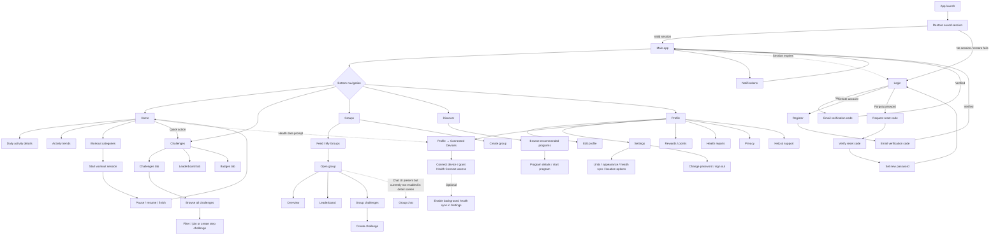

# Vitality App — Current User Flow

**Purpose:** Manager-ready overview of the app flow as currently implemented in the React Native client. This reflects the navigation and visible journeys in the codebase; it is not a product roadmap.

## Manager summary

- **Entry and account access:** the app restores a saved session on launch. New sign-ins and registrations use email verification; password recovery uses a separate reset-code flow.
- **Core app:** five tabs provide Home, Challenges, Groups, Discover, and Profile.
- **Health and activity:** Home summarizes activity and launches workouts, activity details, and trends. Device connection and Health Connect permissions are user-controlled from Profile; background sync is optional in Settings.
- **Engagement:** users can browse challenges, leaderboards and badges; create or open groups and view group overview, leaderboard and challenges; and browse recommended programs.
- **Account support:** Profile links to rewards, reports, privacy, settings, and help. Notifications are reachable from the app shell. An expired session returns the user to Login.

## Current implementation notes

- Onboarding screens exist in the source tree, but onboarding is not registered in the active root navigator; launch currently routes to Login or the restored main app.
- Google sign-in buttons are present in the UI, but the README states Google OAuth configuration is unavailable. Email/password is the active documented sign-in path.
- A program detail component and start-program interaction exist, but the Discover stack currently registers only the Discover screen; confirm its presentation path before treating it as a standalone navigation route.
- Group chat UI/service code exists, but the chat tab is commented out in the group detail screen and requires socket configuration.
